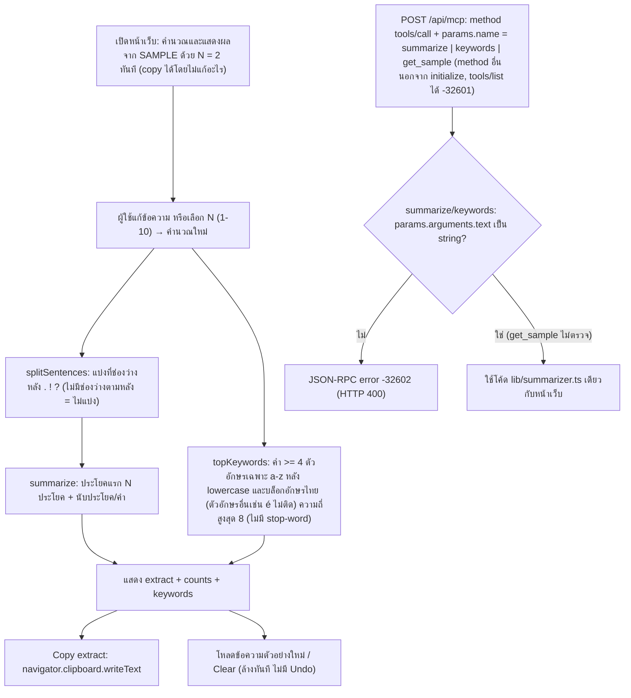

# 01 — Business process (As-Is / To-Be)

ai-text-summarizer-web (Text Summarizer) คือเครื่องมือฝั่ง client ที่ตัดประโยคแรก N ประโยค (extractive ไม่มี LLM) พร้อมนับคำและคำสำคัญ สำหรับผู้เยี่ยมชม portfolio และคนที่ต้องการสรุปหยาบ ๆ

Last reviewed: 2026-11-28 · commit `768758e`

## As-Is (จากโค้ดวันนี้)

Sources: `app/page.tsx`, `lib/summarizer.ts`, `app/api/mcp/route.ts`, `PRODUCT.md`

ข้อเท็จจริงจากโค้ด/เอกสาร:

- ไม่มีการเก็บข้อมูล บัญชี หรือ analytics; ภาษาไทยไม่ถูกตัดคำ (แบ่งประโยคที่ช่องว่างหลัง . ! ? เท่านั้น เช่น `หนึ่ง!สอง` ยังเป็นประโยคเดียว)
- error ฝั่งเว็บและ server ไป Sentry เมื่อมี `NEXT_PUBLIC_SENTRY_DSN` (`lib/sentry.ts`); `PRODUCT.md` ว่าตั้งบน Vercel แล้ว แต่ใช้ได้เมื่อ deploy ครั้งถัดไป [ต้องยืนยัน]
- CI (`ci.yml`) ไม่มีขั้น deploy; deploy แยกต่างหาก (ดู G1)
- Clear ล้างข้อความทันทีโดยไม่มี Undo (`PRODUCT.md` §Known limits)

## To-Be

ไม่มี To-Be ที่เขียนไว้

## Gap

| ID | As-Is → To-Be | Status | Owner | Evidence |
|---|---|---|---|---|
| G1 | Vercel Git link ชี้ repo ชื่อเก่า push `main` จึงไม่ deploy (deploy ด้วย CLI เท่านั้น) → owner เชื่อม Vercel Git กับ repo นี้ | todo | owner | `PRODUCT.md` §Live URL and deploy state (owner action D9) |
| G2 | ไม่มี To-Be ของกระบวนการ → owner กำหนด (หรือยืนยันว่าแอปนี้คงขอบเขตปัจจุบัน) | decide | owner | ไม่มีใน `PRODUCT.md` / `docs/` |
| G3 | Clear ล้างข้อความทันทีไม่มี Undo → ทำ Clear แบบย้อนได้ตาม `APP-SHELL.md` (เลื่อนไว้ ตาม `PRODUCT.md` §Known limits) | todo | claude | `PRODUCT.md` §Known limits; `APP-SHELL.md` |

## Open questions

- production ตามหลัง `main` (ไม่มี Sentry, MCP route แบบ template, ตัวนับคำเดิม) ตาม `PRODUCT.md` [ต้องยืนยัน]
